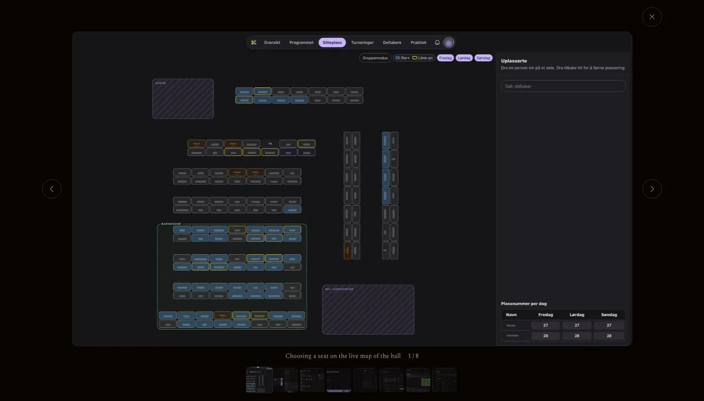
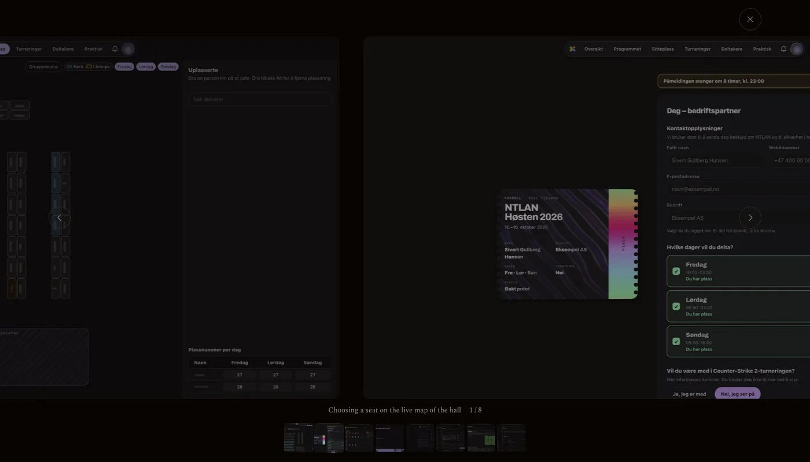

# react-motion-lightbox

A lightbox for React. It opens out of the thumbnail you clicked and closes back into it.

I built it for my own site, [gullberg.no](https://gullberg.no), and pulled it out into a package so [Gryt](https://gryt.chat) can use it too.

Try it at [lightbox.gullberg.no](https://lightbox.gullberg.no).





## What it does

- Opens out of the thumbnail when you tell it which one. Without one, it fades in.
- You can drag the pictures, flick them, and grab one while it's still moving.
- Zoom with a double click or tap, the scroll wheel, two fingers, or `+` and `-`. It goes up to 8x.
- Esc and the arrow keys work, and so does swiping. While zoomed in, the arrow keys move around the picture.
- Click the empty space around the picture to close it. Clicking the picture itself goes to the previous or next one, depending on which half you click.
- It's a native `<dialog>`, so focus stays inside while it's open. When it closes, focus goes back to where it was.
- It loads the next and previous picture before you get there.
- With reduced motion turned on, nothing slides. It switches straight away.
- There's no icon library and no CSS framework. You get one stylesheet you can theme with CSS variables.

You can draw videos with your own player, and put your own buttons and text at the top.

There's also a small one for the page, `Gallery`. It shows one picture at a time in a box, and opens the lightbox when you click it.

For React Native there's [react-native-motion-lightbox](https://github.com/sivert-io/react-native-motion-lightbox), with the same props wherever they make sense.

## Install

```sh
npm install react-motion-lightbox motion
```

You need `react` and `react-dom` 18 or newer, and `motion` 12 or newer.

## Example

```tsx
import { useRef, useState } from 'react'
import { Lightbox, type LightboxItem } from 'react-motion-lightbox'
import 'react-motion-lightbox/styles.css'

const items: LightboxItem[] = [
  { kind: 'image', src: '/photos/one.jpg', alt: 'The harbour at dawn', width: 1600, height: 1067 },
  { kind: 'image', src: '/photos/two.jpg', alt: 'A boat leaving' },
  { kind: 'video', src: '/clips/three.mp4', poster: '/clips/three.jpg', width: 1920, height: 1080 },
]

export function Gallery() {
  const thumbs = useRef<(HTMLImageElement | null)[]>([])
  const [open, setOpen] = useState(false)
  const [index, setIndex] = useState(0)

  return (
    <>
      {items.map((item, i) => (
        <button key={i} onClick={() => { setIndex(i); setOpen(true) }}>
           { thumbs.current[i] = el }} src={item.poster ?? item.src} alt={item.alt} />
        </button>
      ))}

      <Lightbox
        items={items}
        index={index}
        open={open}
        onClose={() => setOpen(false)}
        onIndexChange={setIndex}
        origin={(i) => thumbs.current[i]}
        caption={(item) => item.alt}
        toolbar={(item) => <a href={item.src} download>Download</a>}
      />
    </>
  )
}
```

## Gallery

```tsx
import { Gallery } from 'react-motion-lightbox'

<Gallery
  items={[
    { kind: 'image', src: '/photos/fjord.jpg', width: 5200, height: 3464, focus: [0.78, 0.45], zoom: 1.6 },
    { kind: 'image', src: '/photos/harbour.jpg', width: 6000, height: 4000 },
  ]}
  caption={(item) => item.alt}
/>
```

By default each picture fills the box. `focus` is the point the box centres on, as fractions of the picture. `zoom` is how far it zooms in on that point. Leave them out and you get the middle.

Drag it, flick it, or use the arrows. Click the picture and the lightbox opens out of exactly what was in the box, then shows the whole picture.

It takes the same props as the lightbox and passes them on. On top of those:

| Prop | |
|---|---|
| `aspect` | The box's width over its height. Default `1`, a square. |
| `loading` | `'lazy'` (the default) loads the pictures once the gallery is within half a screen of being seen. `'eager'` loads them straight away: use it for a gallery at the top of the page. |
| `autoplay` | Move on by itself every this many milliseconds, like `6000`. It holds while the pointer or focus is on the gallery or the lightbox is open, adds a pause button, and stays still with reduced motion. |
| `fit` | `'cover'` (the default) fills the box with the part `focus` and `zoom` pick. `'contain'` shows the whole picture inside the box. |
| `peek` | How many pixels of the next picture show at the right edge, so it reads as something to swipe. Default `0`. |
| `gap` | The space between pictures, in pixels. Default `48`. |
| `onLightboxChange(state)` | `'open'`, `'closing'` or `'closed'`. Use it to move things on the page out of the lightbox's way. |
| `onPress(index)` | Called on a click instead of opening the lightbox, if your app has its own viewer. A drag never counts as a click. |
| `clip` | Cut pictures off at the box's edges as they slide. Default `true`. Set it to `false` and they slide past the edges and fade out instead. |

`className` goes on both the gallery and the lightbox. A video shows its `poster`, or your own player if you pass `renderVideo`. `active` is true for the one on screen. If you build a gallery of your own, `cropOf(item, aspect)` gives you the same crop.

## Props

| Prop | |
|---|---|
| `items` | `{ kind: 'image' \| 'video', src, srcSet?, sizes?, alt?, width?, height?, poster?, thumb?, focus?, zoom? }[]`. If you leave out `width` and `height`, it measures the item once it loads. |
| `index`, `open` | Which item to show, and whether the lightbox is open. Change `index` while it's open and it moves there. |
| `onClose` | Someone pressed Esc or the close button. Set `open` to `false` and it animates out. |
| `onIndexChange(index)` | The item on screen changed. |
| `onExited(index)` | The close animation is done and the dialog is gone. |
| `origin(index)` | The element (or a `DOMRect`) an item opens out of and closes back into. Return nothing and it fades instead. |
| `originCrop(index)` | If the thumbnail only shows part of the picture: `[left, top, width, height]` as fractions of it. |
| `renderVideo(item, { active })` | Draw a video yourself. It fills the item's box. |
| `title(item, index)` | Top left. |
| `toolbar(item, index)` | Top right, before the close button. |
| `caption(item, index)` | Under the picture, before the "3 / 12" count. |
| `thumbnails` | The row of thumbnails when there's more than one item. Default `true`. |
| `maxZoom` | Default `8`. |
| `radius` | Corner radius in px. It stays the same all the way through the opening move. Default `12`. |
| `labels` | `{ dialog, close, previous, next, pause, play }`, if you need other words or another language. `pause` and `play` are the gallery's slideshow button. |
| `icons` | `{ close, previous, next, pause, play }`, any React node. The defaults are plain SVGs. |
| `className` | Goes on the `<dialog>`. |

`preload(item)` downloads an item the same way the lightbox will show it. Call it on hover and the picture is there before the click.

`useTrack` and `useTrackPlace` are the track the lightbox moves on. Use them if you want a gallery that moves the same way.

## Theming

Set these on `.rml`, or on a class you pass in `className`:

```css
.rml.my-lightbox {
  --rml-backdrop: rgb(0 0 0 / 0.92);
  --rml-blur: 0px;
  --rml-color: #f4f4f5;
  --rml-muted: #a1a1aa;
  --rml-border: rgb(255 255 255 / 0.2);
  --rml-accent: #e4c590;
  --rml-focus: #fde68a;
  --rml-padding: 1rem clamp(1rem, 4vw, 3rem);
  --rml-gap: 0.75rem;
  --rml-button-size: 2.75rem;
  --rml-caption-size: 0.75rem;
  --rml-thumb-size: 3.5rem;
  --rml-thumb-radius: 0.375rem;
  --rml-frame: #e0b04a;
  --rml-frame-width: 2px;
  --rml-ease: cubic-bezier(0.16, 1, 0.3, 1);
}
```

`--rml-blur` blurs the page behind. The blur and the backdrop come in and go out with the picture as it opens and closes. `--rml-frame` is the frame around the current thumbnail.

The gallery uses the same variables, set on `.rml-gallery`. Its text and buttons take the page's colour unless you set them.

## What I haven't tested

I've run it on React 19 with Motion 12 and 14. React 18 should work, but I haven't tried it. Pinch zoom is written for touch screens, but I've only tested it on a laptop so far.

## License

MIT. The logo is Brown Mushroom from Microsoft's [Fluent Emoji](https://github.com/microsoft/fluentui-emoji), also MIT ([its licence](docs/fluent-emoji-LICENSE)).
